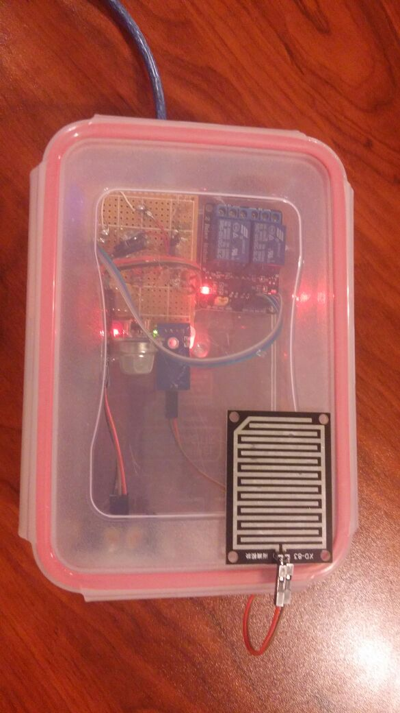

**Herkese Merhabalar,**\
Bu yazımda .NET platformunun bir teknolojisi olan WPF kullanarak ev otomasyonu
kontrol paneli yapmayı anlatacağım. Yaptığım bu projenin başlıca işlevi şudur; 5
farklı sensörden bulunulan ortamın sıcaklığı, nemi, zehirli gaz durumu, ortamda
canlı olup olmadığı, ortamda yağış olup olmadığı Arduino yardımıyla alınır ve bu
sensor dataları C# arayüzünde gösterilir. Eğer onay kutusu işaretlenirse
istenmeyen bir durumda (gaz sızıntısı, eve hırsız girmesi, yağmur için
kurulabilir.) program uyarı olarak girilen adrese bir adet mail
gönderir.[Projenin Arduino ve C# kaynak kodunu buradan indirebilirsiniz.](https://drive.google.com/file/d/0B5j__Lyt9ozbVTRIOVFVcVVWX3c/view?usp=sharing)

**Malzemeler**

- Arduino
- DHT11 Nem ve Sıcaklık Sensörü
- MQ135 Gaz Sensörü
- Yağış Sensörü
- Röle Modulü
- PIR Sensörü
- ESP8266 Wifi Modulü

**Kutu**

**Arduino Kodu**

**Alternatif Arduino Kodu ESP8266 Kullanarak**

**WPF Application**

**Serialden Data Almayla Alakalı Fonksiyonlar**

**Gelen Datayı Parçalara Ayırıp Görüntüleme Fonksiyonları**

**Mail Gönderme Fonksiyonları**

**Mail Gönderince Arayüzün Durumu**

