Hello everyone! In this post, I will show how ordinary LED lights can be used to
find your position indoors. The LEDs keep doing their real job, lighting the
room, while they also blink too fast for the eye to notice and broadcast their
ID and location. A small receiver with four photodiodes picks up that light,
decodes the messages, and estimates where it is.

I built the whole chain: the photodiode receiver, a 10 W LED transmitter, the
modulation and demodulation running on STM32 microcontrollers, and two
localization methods. In the end, the angle of arrival method found the
direction of a light source with about 13.6° accuracy, and the received signal
strength method located the receiver with an average error of about 13 cm.

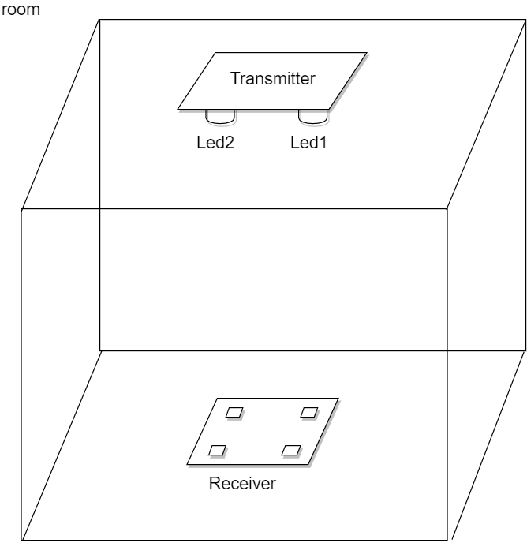
_3D view of the system_

### Why Light?

Light bulbs are everywhere, and the infrastructure for them, power and mounting
points, is already in every building. As LEDs replace older bulbs, that
infrastructure becomes something more: an LED can be switched on and off
millions of times per second, so every lamp can also be a tiny transmitter.
This is the idea behind visible light communication (VLC), which is becoming a
popular complement to radio based systems.

Indoor navigation is a hard problem. GPS does not work inside buildings, and
robots, drones, and people all need to know where they are. Using the lights
that are already installed would solve it without any extra infrastructure.
Some places where this could help:

- **Factories:** navigation for autonomous robots. With millimeter accuracy, it
  could even replace encoders or laser range finders as position feedback.
- **Shopping malls:** guiding customers through large, confusing buildings, and
  pushing information such as discounts from nearby shops.
- **Museums:** location based guides that make visits more interactive.
- **Hospitals:** guiding wheelchairs and other moving equipment with VLC
  beacons [1].
- **Drones:** indoor flight today mostly relies on complex camera systems. VLC
  could provide a simpler position feedback.

The scope of this project was a simplex (one way) link with modest data rates.
High bandwidth VLC, duplex links, networking and MAC protocols, and security
were out of scope.

### Related Work

VLC positioning systems fall into two groups. **Camera based** systems decode
the light with a phone camera. A neat trick some of them use is the rolling
shutter: a CMOS sensor does not capture the whole frame at once, so a
modulated light source shows up as stripes in the image, and the stripes
encode the data. These systems need a lot of processing, are limited by the
camera frame rate, and are hard to make work across many camera models.
**Photodiode based** systems, like mine, are simpler and much faster.

| Work                                     | Year | Modulation   | Localization        | Accuracy       |
| ---------------------------------------- | ---- | ------------ | ------------------- | -------------- |
| Carrier allocation VLC [2]               | 2014 | QPSK         | Trilateration       | 6 cm           |
| Hadamard matrix design [3]               | 2017 | OOK          | Hadamard matrices   | 4 cm           |
| Wearables Can Afford [4]                 | 2015 | Polarization | AoA, camera         | sub-meter      |
| Rotated environments [5]                 | 2016 |              | RSS, least squares  | 13 cm (sim.)   |
| Single LED beacon, 3D [6]                | 2016 | OOK          | RSS and AoA         | 7.3 cm         |
| LED tracking and ID estimation [7]       | 2014 | 4-PPM        | Camera              | 5.37 cm        |
| Visible light and accelerometer [8]      | 2014 | OOK          | RSS                 | 25 cm          |
| OFDM VLC positioning [9]                 | 2016 | OFDM         | RSS                 | 4 cm           |
| Mobile robot localization [10]           | 2016 | Multi freq.  | RSS                 |                |
| Investigation of VLC positioning [11]    | 2016 | Frequency ID | RSS                 | 39 cm          |

A few ideas from these papers shaped my design:

- **Polarization modulation [4]:** each light gets a one pixel LCD in front of
  it that changes the polarization of the light. The receiver has a fixed
  polarizer and sees the changes, while human eyes cannot perceive
  polarization at all, so the light looks perfectly steady.
- **One LED is enough [6]:** combining AoA and RSS with a 3D orientation sensor
  allows a 3D position from a single LED.
- **Orientation matters [5, 8, 12]:** a tilted receiver sees a very different
  signal strength. Modelling the tilt and correcting it with an accelerometer
  removes much of that error.
- **Modulation matters [9]:** OFDM gave clearly better positioning accuracy
  than simple on off keying.
- **Frequency per LED [10, 11]:** each LED blinks at its own frequency, and the
  receiver separates them with filters or an FFT and compares the amplitudes.

There are also commercial systems such as Qualcomm Lumicast, Philips indoor
positioning, and ByteLight.

### System Overview

The system has two sides. The **transmitter** drives LEDs on and off to send
data. Nothing exotic happens to the light itself: data is carried only by the
on off waveform. The **receiver** has 4 photodiodes. Their current is amplified,
sampled by the ADC of an STM32F405 microcontroller, and stored in a buffer. The
same buffer feeds two pipelines: demodulation, which recovers the LED's ID and
coordinates, and localization, which estimates where the light comes from.

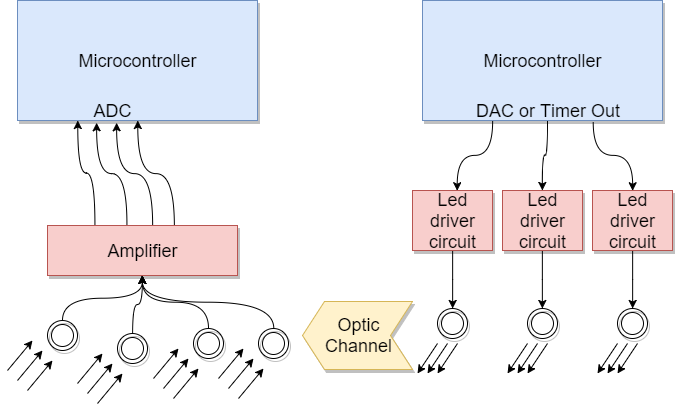
_Block diagram of the system_

### The Receiver

#### Choosing the Light Sensor

I tested three candidates, all of which respond roughly linearly to light, have
a wide viewing angle, and are reasonably fast:

- a photodiode with a transimpedance amplifier,
- a photodiode with a simple resistor,
- a small solar cell.

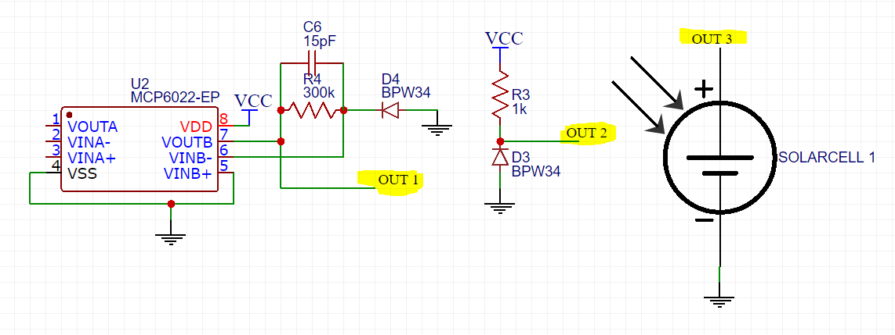
_Test circuits for the three receiver candidates_

An LED blinking at 1 kHz was pointed at each circuit under different light
levels, and I measured the output with an oscilloscope.

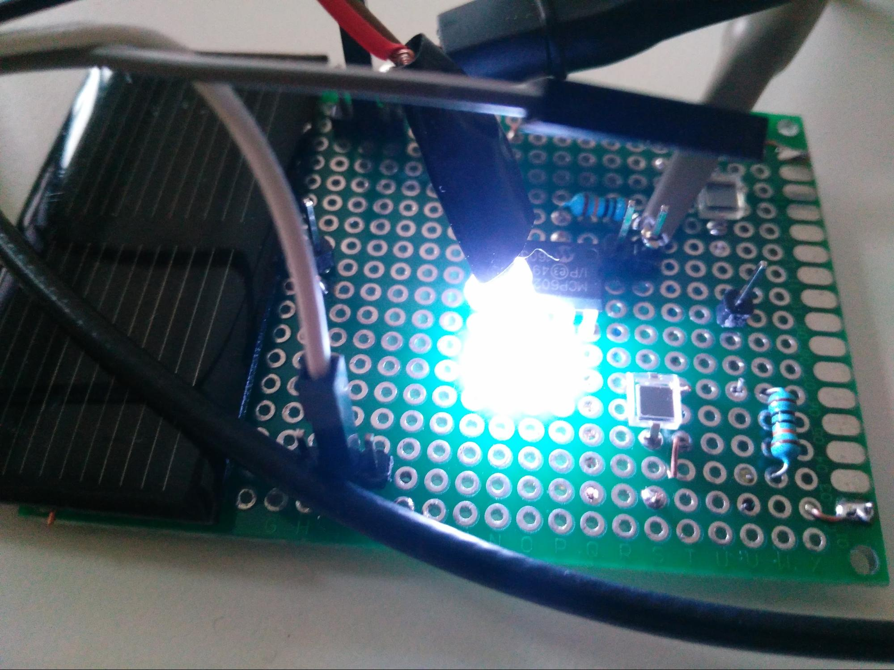
_Receiver test setup_

| Receiver                                | Rise time   | Fall time   | Notes                          |
| --------------------------------------- | ----------- | ----------- | ------------------------------ |
| Photodiode + transimpedance amplifier   | 0.9 to 1.1 µs | 0.9 to 1.1 µs | about 0.6 V overshoot          |
| Photodiode + 100 kΩ resistor            | 10 µs       | 10 µs       | small signal                   |
| Solar cell                              | 100 µs      | 300 µs      | 0.5 V peak to peak             |

The photodiode with a transimpedance amplifier was by far the fastest, and it
worked over the widest range of light levels, so I went with it.

#### The Photodiode: BPW34

The BPW34 is a cheap, easy to find PIN photodiode [13]. Avalanche photodiodes
can reach the GHz range, but I did not need more than about 1 MHz. Its
important specs:

- **Spectral range 430 to 1100 nm:** this covers most of the visible band
  (about 380 to 780 nm).
- **Half sensitivity angle ±65°:** a wide view angle is important for
  localization.
- **Rise and fall time about 100 ns:** this gives a maximum frequency of
  roughly

$$f_{max} = \frac{1}{t_r + t_f} = \frac{1}{100\,\text{ns} + 100\,\text{ns}} = 5\,\text{MHz}$$

Its current is very linear with illuminance, which makes it a good fit for
signal strength based localization.

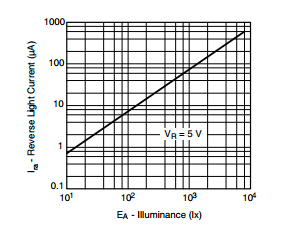
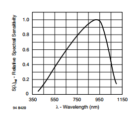
_BPW34 photocurrent versus illuminance, and relative spectral sensitivity [13]_

#### The Transimpedance Amplifier

A photodiode produces a current, but the ADC measures a voltage, so a
transimpedance amplifier converts one to the other. The gain is set by the
feedback resistor. In the first design, I picked it so that 1000 lux, about
100 µA, would give the full 3.3 V range: $R_f = 3.3\,\text{V} / 100\,\mu\text{A} = 33\,\text{k}\Omega$.

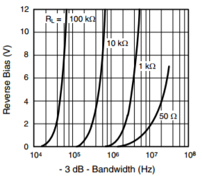
_BPW34 bandwidth versus reverse bias voltage [14]_

The first prototype had a long settling time and ringing after every edge.

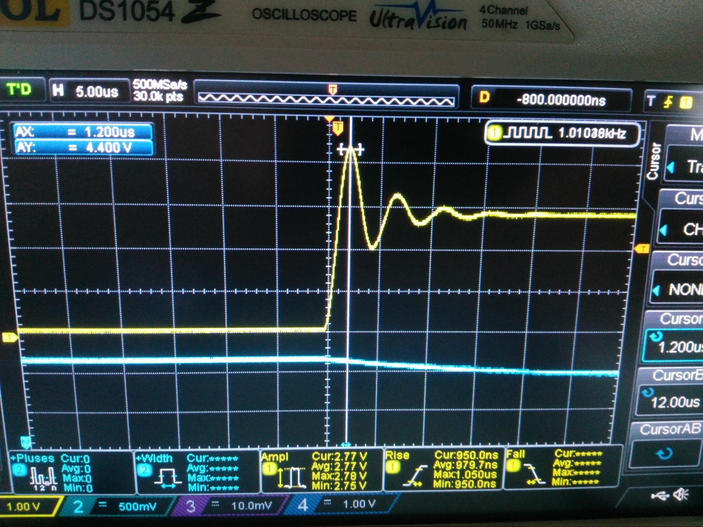
_Ringing and long settling time in the first prototype_

The reason is that the photodiode's capacitance at the op amp input makes the
circuit unstable unless a small capacitor is placed across the feedback
resistor. That capacitor also limits the bandwidth. The highest closed loop
bandwidth that still gives a 45° phase margin is [15]:

$$f_{45} = \sqrt{\frac{f_u}{2\pi R_f (C_{in} + C_m + C_d)}}$$

where $f_u$ is the op amp's unity gain frequency, $R_f$ is the feedback
resistor, $C_{in}$ is the photodiode plus board capacitance, and $C_m$ and
$C_d$ are the op amp's common mode and differential input capacitances.

In practice, I did not need high speed. The real challenge was choosing a gain
high enough to work in dim light without saturating from other light sources.
The final design uses a 40 kΩ feedback resistor and a bandwidth of about
36 kHz. I also replaced the MCP6022 with an OPA4353 [16], which has a 44 MHz
unity gain bandwidth, lower noise and distortion, and four amplifiers in one
package, exactly one per photodiode. Its only downside is the price. I sampled
at 100 kHz, which comfortably covers the signals I used.

#### The Receiver Board

Localization needs four photodiodes that are exactly aligned, and hand wiring
four amplifier circuits was error prone. So I designed a PCB.

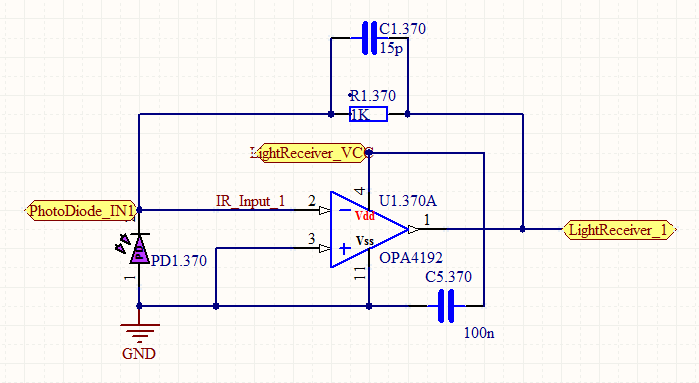
_Schematic of one receiver channel_

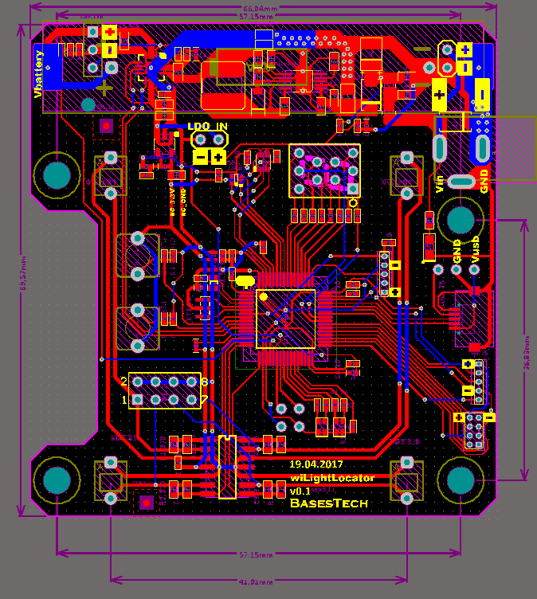
_Receiver PCB layout_

The board has:

- an STM32F405, chosen for its speed and its floating point unit for DSP,
- the light receiver: an OPA4353 and four BPW34 photodiodes,
- a user interface with LEDs, buttons, and a 7 segment display,
- an MMA8652 accelerometer to measure the board's orientation,
- a power section with regulators, a battery charger, and battery protection,
- a USB port for power and for streaming data to a computer.

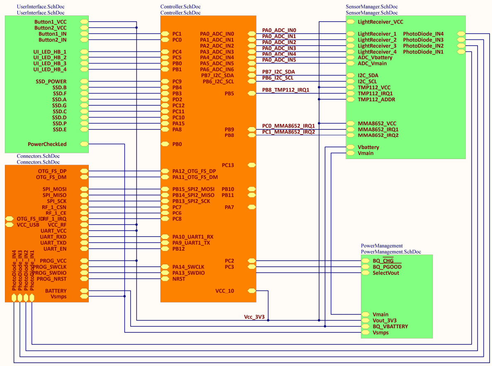
_STM32F405 pin assignments, grouped into UI, connectors, controller, sensors,
and power_

The photodiode amplifiers go to ADC pins, the accelerometer to I2C, and all
data goes to the computer over USB as a virtual serial port. The photodiodes
are placed symmetrically so that their relative signal strengths reveal the
direction of the light. The battery holder is on the back, and the indicator
LEDs and display are on the front, away from the sensors.

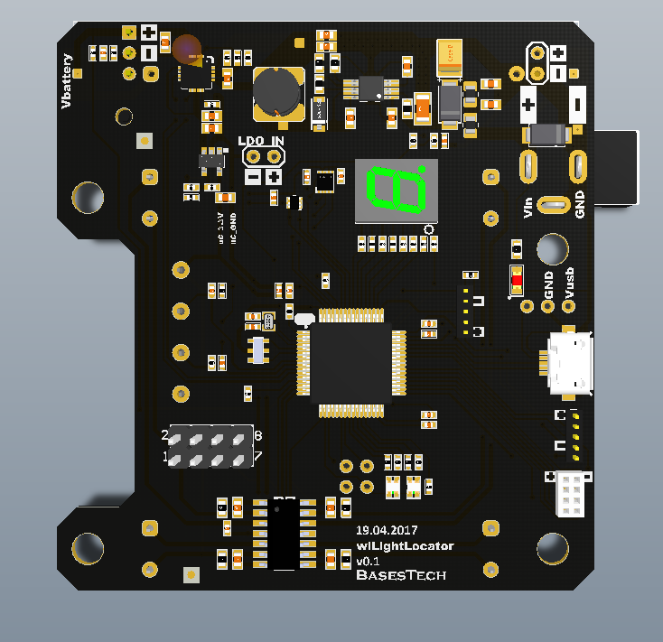
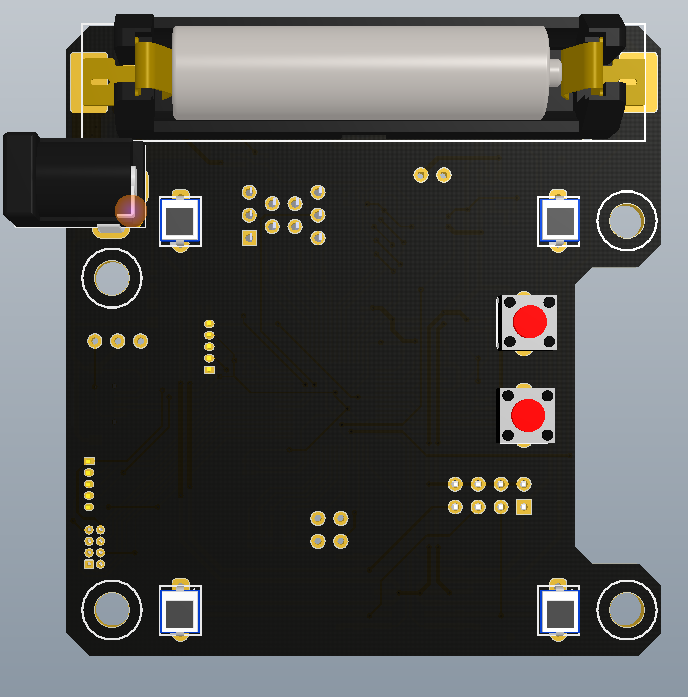
_3D model of the receiver board_

The STM32F405 runs at 168 MHz, with 48 MHz for USB, 84 MHz for the timers, and
42 MHz for the ADCs.

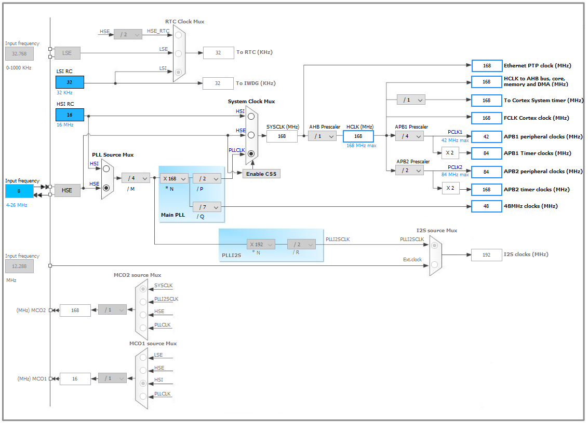
_STM32F405 clock configuration_

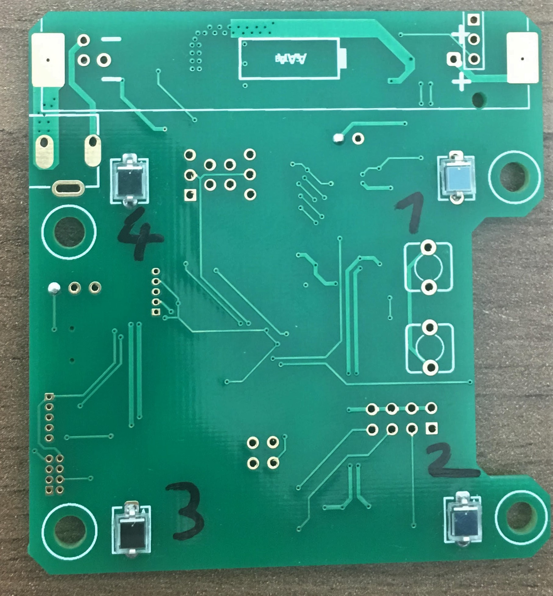
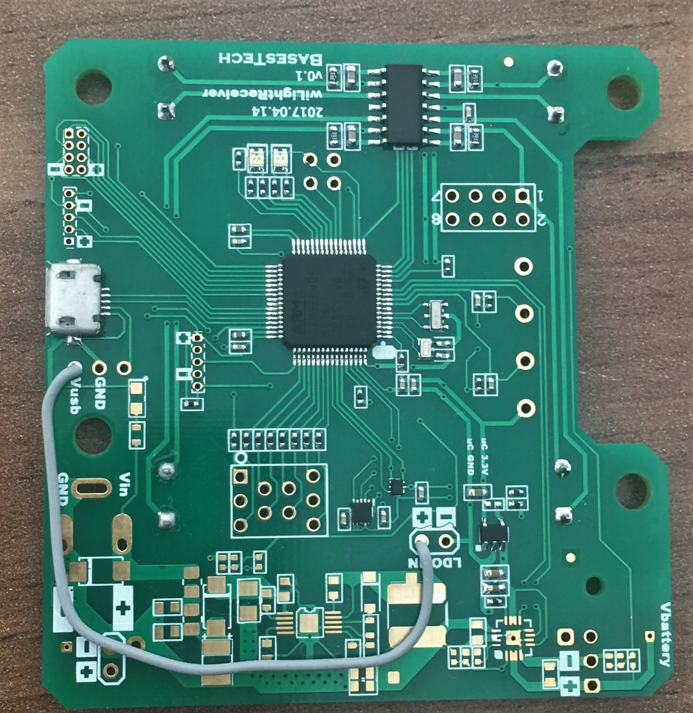
_The assembled receiver board_

### The Transmitter

Early tests used small white LEDs driven straight from microcontroller pins,
but localization over a useful range needs much more light. The final
transmitter drives 10 W power LEDs at high frequencies.

#### LED Driver

Power LEDs are usually driven with constant current. My first design was the
circuit below, simulated in LTspice. A diode holds the op amp's positive input
at 0.7 V, and the op amp keeps the voltage across a 0.5 Ω sense resistor at
the same 0.7 V, so the current is fixed at $I = 0.7\,\text{V} / 0.5\,\Omega = 1.4\,\text{A}$.

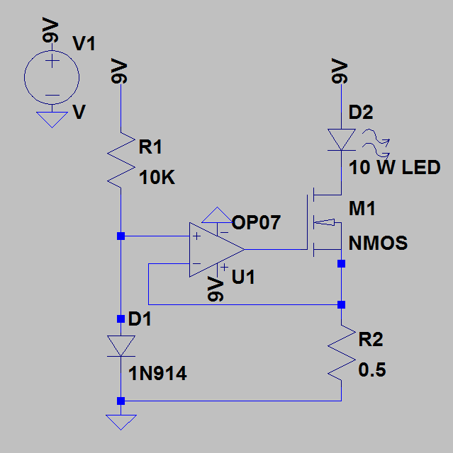
_Constant current LED driver design_

It worked, but the MOSFET dissipated a lot of power and needed cooling, and the
circuit oscillated at around 900 kHz, which would add noise right where my
modulation lives. Since LED brightness is also quite linear with drive level, I
switched to a simple switch: an IRL510 logic level N-channel MOSFET, driven
directly by the microcontroller's timer outputs.

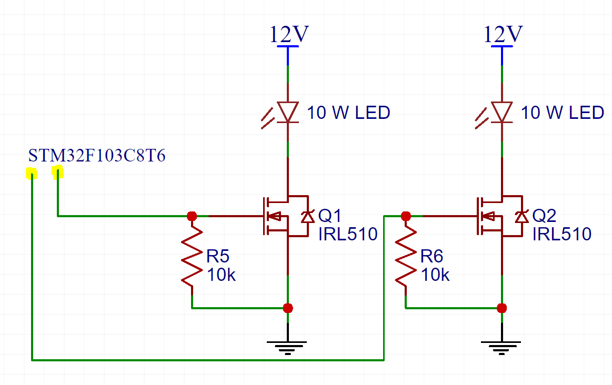
_Transmitter schematic_

- **IRL510 [17]:** handles 5.6 A, switches up to about 10 MHz, and has an on
  resistance of only 0.54 Ω, so it stays cool without a heatsink.
- **STM32F103C8T6:** the transmitter does not need much computing power, but it
  needs precise timers to generate the waveforms, which this chip has plenty
  of. It runs at 32 MHz from an 8 MHz crystal.
- **Arduino Due:** since LED brightness is fairly linear with current, I also
  tried waveforms other than square pulses. The Due's built in DAC made that
  easy.

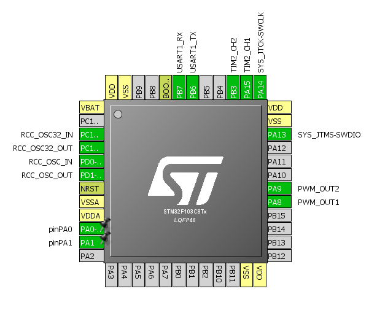
_STM32F103 pin assignments_

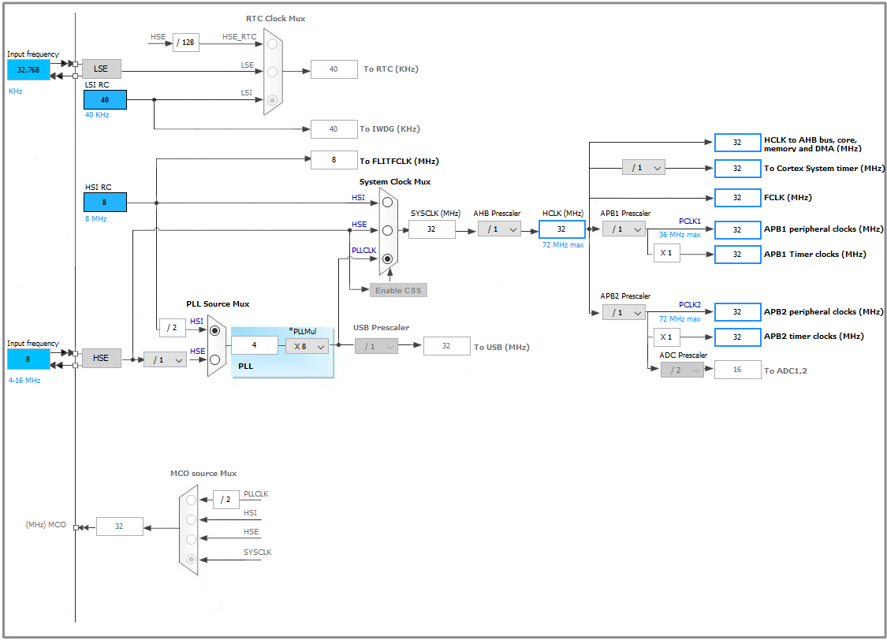
_STM32F103 clock configuration_

**Cooling:** with modulation, the LEDs run at about 50% duty cycle, but a 10 W
LED still gets hot quickly. Each LED got its own aluminum heatsink.

#### Transmitter Tests

The transmitter worked cleanly at 1 MHz. I did not test higher, since that is
already well beyond what the receiver needs, and the LED itself has more than
10 MHz of bandwidth [18]. One problem showed up: 50 Hz mains ripple on the
power supply leaked into the LED waveform. A 220 µF capacitor at the supply
input fixed it.

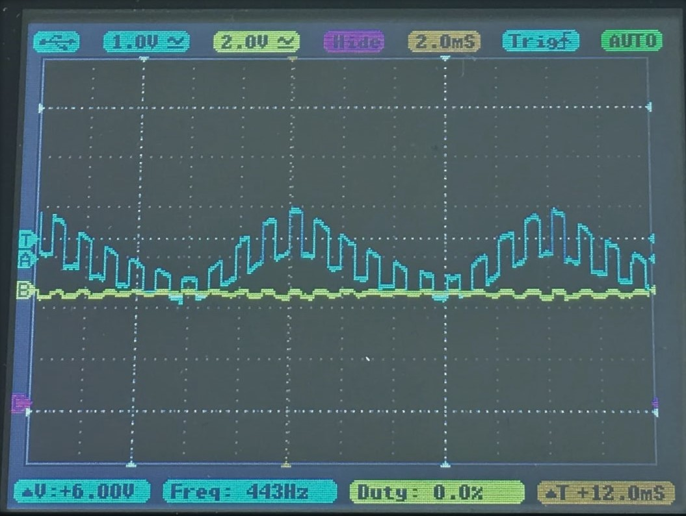
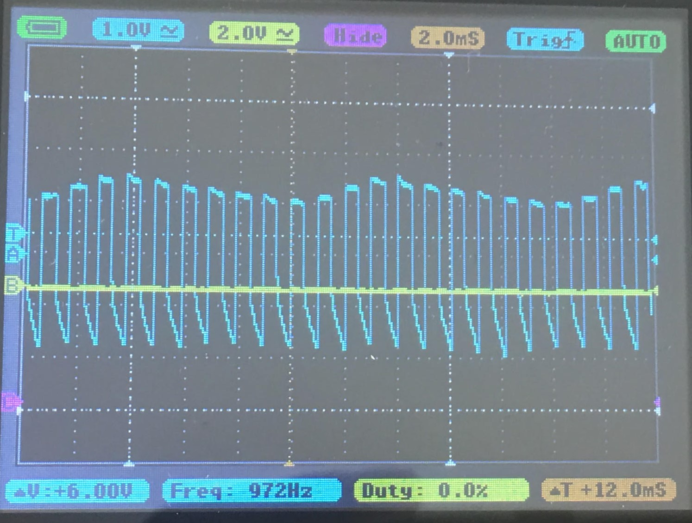
_LED waveform before and after adding the supply filter capacitor_

### Communication

Visible light was chosen precisely so the LEDs can keep lighting the room.
That puts two constraints on the modulation: it must not flicker visibly, and
it should keep the average light output high.

#### First Tests with UART

The first link was plain UART: the STM32F103's hardware UART drove the LED
directly, and the oscilloscope's protocol analyzer decoded the photodiode
output. This was a quick way to see how the receiver and transmitter respond to
real data before finalizing the design. The link worked up to 115200 baud. I
did not test the range at this stage.

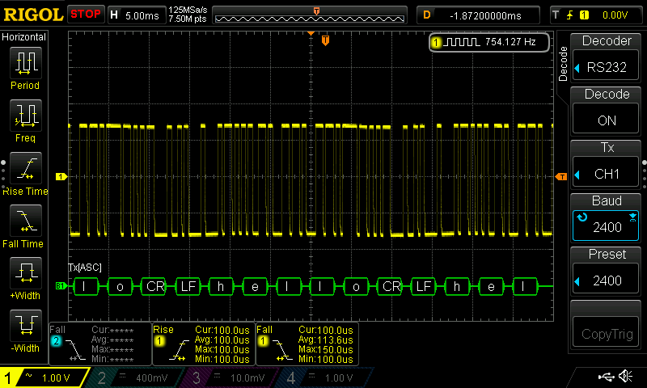
_UART over light at 2400 baud_

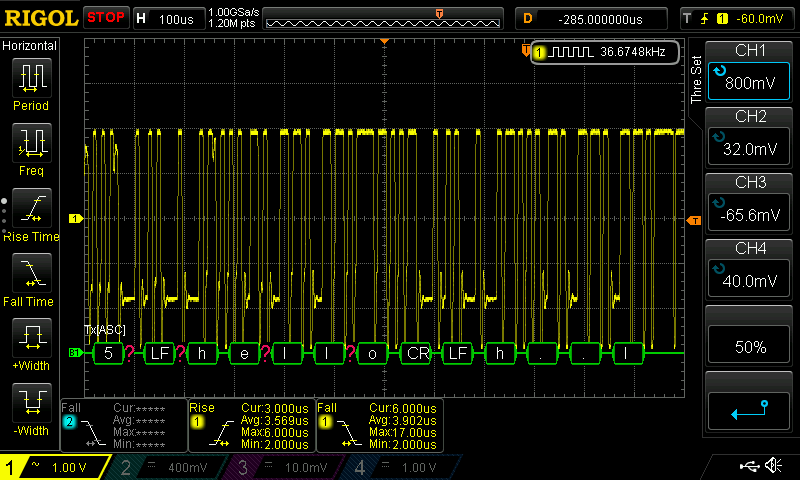
_UART over light at 115200 baud_

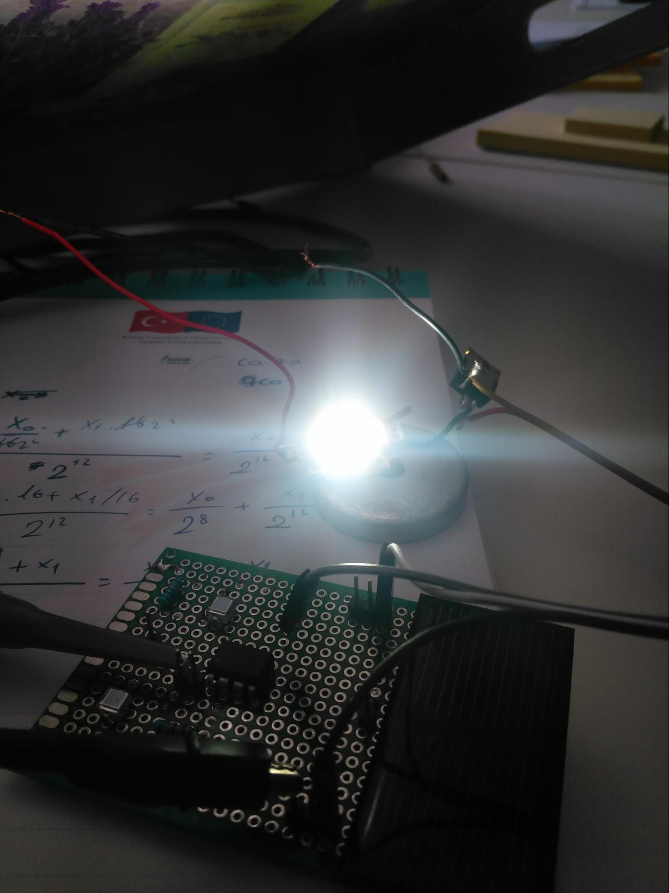
_A 10 W white LED switched by an IRL510, running at 25% power_

#### Frequency Shift Keying

With many LED beacons in a room, they need to share the medium. Time division
would require all transmitters to be synchronized. With frequency division,
each LED gets its own frequencies and they can all transmit at the same time
without any shared clock. Working in the frequency domain also removes the DC
light level, such as daylight, from the received signal, which helps both
decoding and localization. So I chose frequency shift keying (FSK).

**Modulator.** The STM32F103 uses two timers. Timer 1 ticks once per symbol,
and its interrupt loads the next symbol from a buffer. Timer 2 generates the
output square wave, and its frequency is set by the current symbol. I started
with binary FSK, two frequencies for 0 and 1, and then moved to 16-FSK, where
each symbol is one of 16 frequencies and carries 4 bits, which quadruples the
data rate.

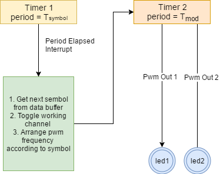
_FSK transmitter with two timers_

**Demodulator.** On the receiver, a timer triggers the ADC at a fixed sampling
rate, and DMA copies the samples into RAM without involving the CPU. When the
buffer is full, an interrupt fires and the CPU processes it while DMA keeps
filling the next one.

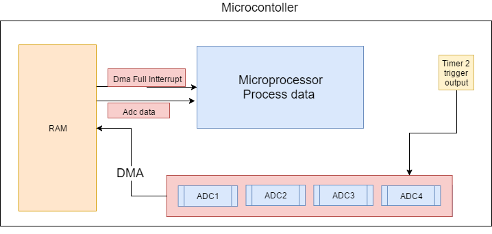
_Data acquisition with a timer triggered ADC and DMA_

Each buffer is split into the four photodiode channels. An FFT turns each
window into a spectrum, a peak detector finds the strongest frequency, and that
frequency maps back to a symbol. The same data also feeds the localization
pipeline.

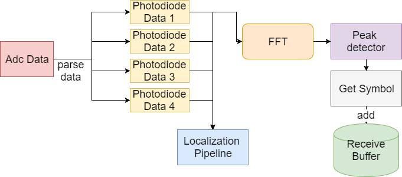
_FSK demodulation and localization pipeline_

I wrote a small DSP library for this and benchmarked its FFT on a few boards:

| FFT size | Arduino Nano | Arduino Due | STM32F405 (168 MHz) |
| -------- | ------------ | ----------- | ------------------- |
| 16       | 2 ms         |             |                     |
| 32       | 6 ms         |             |                     |
| 64       | 16 ms        | 2 ms        | 0.615 ms            |
| 128      |              | 6 ms        | 1.215 ms            |
| 256      |              | 10 ms       | 2.549 ms            |

The STM32F405 is clearly the fastest of the three.

#### Pulse Position Modulation

I also implemented a simple 4-PPM link in software. Each 2 bit symbol is sent
by placing a pulse in one of four time slots. I inverted the polarity, so the
"pulse" is actually a short dark gap and the LED is on about 75% of the time.
That keeps the room bright while still sending data.

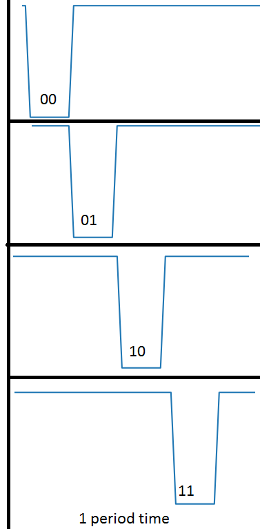
_4-PPM symbol coding_

#### Interference

Interference from other light was one of the biggest problems. If any light
source saturates the amplifier, nothing else can be received. Making it worse,
the BPW34 is most sensitive around 900 nm, in the infrared, where my white LEDs
emit almost nothing but sunlight and incandescent bulbs emit a lot. I tried
color and polarization filters to make the receiver more selective.

### Localization

#### Angle of Arrival

The first method estimates the direction of the light. To make the four
photodiodes more directional, I designed a 3D printed mount that tilts each
one outward by 30°. The photodiode facing the light then gets noticeably more
signal than the others, and comparing the four gives the angle. With two
receivers measuring the angle to the same LED, triangulation gives the
position.

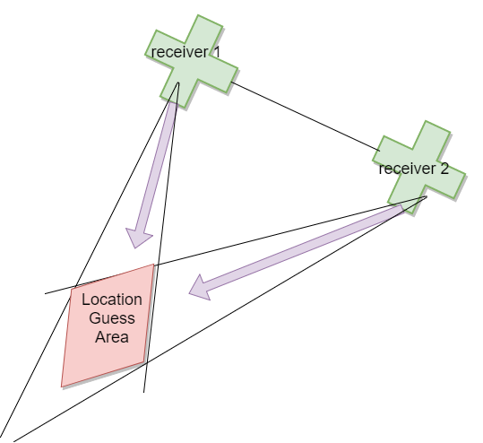
_Angle of arrival with two receivers and triangulation_

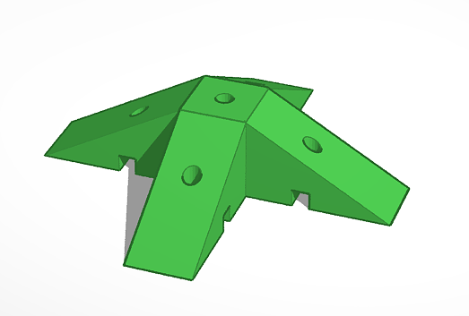
_3D printed mount that tilts the photodiodes by 30°_

At about 1 m distance, the average angle error was 13.6° in 2D.

#### Received Signal Strength

The second method estimates the distance to each LED from how bright its
signal is. Because I measure the amplitude of the modulated signal, not the
total light, the constant background light drops out.

For a Lambertian LED, the channel gain between transmitter and receiver
is [10, 11]:

$$G = \frac{(m+1)A}{2\pi d^2}\cos^m(\phi)\cos(\psi)$$

where $A$ is the photodiode area, $d$ is the distance, $\phi$ is the angle at
which the light leaves the LED, $\psi$ is the angle at which it hits the
receiver, and $m$ is the Lambertian order of the LED. The received power is
$P_r = G\,P_t$.

For a standard LED, $m = 1$. When the receiver is level and directly below the
LED's plane, both angles satisfy $\cos\phi = \cos\psi = H/d$, where $H$ is the
height difference. Substituting and solving for $d$:

$$d = \sqrt[4]{\frac{A H^2 P_t}{\pi P_r}}$$

Since the height is known, the horizontal distance follows from
$d_{xy} = \sqrt{d^2 - H^2}$. Each LED sends its own coordinates over VLC, so
the receiver ends up with one distance per LED, and solving these circle
equations together gives its position. All of this runs on the
microcontroller, which streams the coordinates over USB.

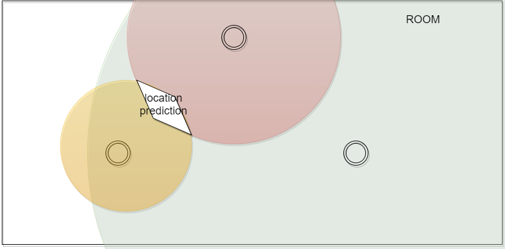
_Trilateration from received signal strength_

To test it, I divided a 105 cm by 45 cm area at 1 m below the transmitters
into a grid, took three measurements in each cell with the receiver level, and
averaged the error. The errors range from about 9 to 16 cm, with an average of
about 13 cm. Errors grow toward the edges, where the light arrives at steeper
angles.

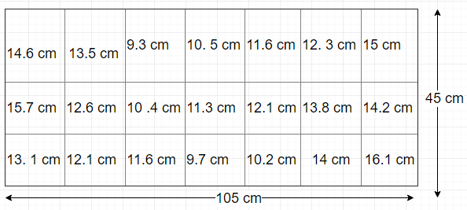
_Average position error in each cell of the test grid_

#### Orientation

Both methods assume the receiver is level, and since the photodiodes only see
about ±65°, even a small tilt changes the readings. The MMA8652 accelerometer
measures that tilt using gravity as a reference. Because the gravity vector
always has a magnitude of 1 g, a 3 axis accelerometer gives only two
independent angles, pitch and roll; rotation around the vertical axis cannot
be measured this way [19].

_Axes of the receiver_

With the rotation order $R_{xyz} = R_x(\phi) R_y(\theta) R_z(\psi)$, gravity
$[0, 0, 1]^T$ seen by the accelerometer becomes:

$$\frac{G_p}{\lVert G_p \rVert} = \begin{bmatrix} -\sin\theta \\ \cos\theta\sin\phi \\ \cos\theta\cos\phi \end{bmatrix}$$

Solving for the roll angle $\phi$ and the pitch angle $\theta$:

$$\tan\phi = \frac{G_{py}}{G_{pz}}, \qquad \tan\theta = \frac{-G_{px}}{\sqrt{G_{py}^2 + G_{pz}^2}}$$

With these angles, the tilt can be compensated in the signal strength model.
According to [12], this kind of correction removes 67% to 95% of the error
caused by a tilted receiver. I derived and implemented the model, but did not
fully test it.

### Results

- **Receiver:** BPW34 photodiodes with an OPA4353 transimpedance amplifier,
  40 kΩ gain, and about 36 kHz bandwidth.
- **Transmitter:** drives three 10 W LEDs at once, tested up to 1 MHz. Square
  wave FSK comes from the timers, and arbitrary waveforms from the DAC.
- **Communication:** UART, binary FSK, 16-FSK, and 4-PPM, all modulated and
  demodulated on microcontrollers.
- **Angle of arrival:** 13.6° average angle error.
- **Received signal strength:** about 13 cm average position error.
- **Orientation:** modelled, but not fully tested.

### Conclusion

Visible light is a very promising way to localize indoors. It reuses lighting
that is already installed, it can carry data at high rates, it is generally
more accurate than radio based positioning, and it updates much faster than
camera based systems. That makes it a good fit for real time uses such as
controlling robots and drones.

The project touched many areas at once: analog design for the photodiode
amplifier, digital signal processing, digital communication, PCB design, and
embedded software. That made it complex, but also one of the most instructive
things I have built.

### Future Work

- Use color filters to cut down interference from other light sources.
- Improve the communication link, since better decoding also improves the
  signal strength estimates.
- Add a full IMU to compensate the tilted receiver error properly.
- Use more complex modulation and higher frequencies for higher data rates.
- Move parts of the processing into hardware: comparators for thresholding,
  and an FPGA for the DSP and demodulation, which can run at much higher
  frequencies than software.

### References

1. N. U. Hassan, A. Naeem, M. A. Pasha, T. Jadoon, and C. Yuen, "Indoor
   Positioning Using Visible LED Lights: A Survey," _ACM Computing Surveys_,
   2015.
2. H. S. Kim, D. H. Kwon, S. H. Yang, Y. H. Son, and S. K. Han, "Implementation
   of real-time indoor positioning system using carrier allocation visible
   light communication," 2014.
3. J. K. Park, T. G. Woo, M. Kim, and J. T. Kim, "Hadamard Matrix Design for a
   Low-Cost Indoor Positioning System in Visible Light Communication," _IEEE
   Photonics Journal_, 2017.
4. Z. Yang, Z. Wang, J. Zhang, C. Huang, and Q. Zhang, "Wearables Can Afford:
   Light-weight Indoor Positioning with Visible Light," in _Proc. MobiSys_,
   2015.
5. J. Yan and B. Zhu, "A visible light communication indoor localization
   algorithm in rotated environments," 2016.
6. Y. Hou, S. Xiao, M. Bi, Y. Xue, W. Pan, and W. Hu, "Single LED Beacon-Based
   3-D Indoor Positioning Using Off-the-Shelf Devices," _IEEE Photonics
   Journal_, 2016.
7. Y. Nakazawa, H. Makino, K. Nishimori, D. Wakatsuki, and H. Komagata,
   "LED-tracking and ID-estimation for indoor positioning using visible light
   communication," in _Proc. IPIN_, 2014.
8. M. Yasir, S. W. Ho, and B. N. Vellambi, "Indoor Positioning System Using
   Visible Light and Accelerometer," _Journal of Lightwave Technology_, 2014.
9. M. Aminikashani, W. Gu, and M. Kavehrad, "Indoor positioning with OFDM
   Visible Light Communications," in _Proc. IEEE CCNC_, 2016.
10. H. Sharifi, A. Kumar, F. Alam, and K. M. Arif, "Indoor localization of
    mobile robot with visible light communication," 2016.
11. Y. C. See, N. M. Noor, and C. Tan, "Investigation of Indoor Positioning
    System using Visible Light Communication," 2016.
12. E. M. Jeong, S. H. Yang, H. S. Kim, and S. K. Han, "Tilted receiver angle
    error compensated indoor positioning system based on visible light
    communication," _Electronics Letters_, 2013.
13. Vishay, "BPW34 Silicon PIN Photodiode," datasheet.
14. Vishay, "Measurement Techniques," application note, 2012.
15. L. Orozco, "Optimizing Precision Photodiode Sensor Circuit Design," Analog
    Devices, 2014.
16. Texas Instruments, "OPA353, OPA2353, OPA4353 High-Speed, Single-Supply,
    Rail-to-Rail Operational Amplifiers," datasheet.
17. Vishay, "IRL510 Power MOSFET," datasheet, 2011.
18. Wayjun Technology, "10W Epistar High Power LED," datasheet, 2012.
19. NXP, "Tilt Sensing Using a Three-Axis Accelerometer," application note
    AN3461, 2013.
