Hello everyone! Today's topic is Electrical Impedance Tomography (EIT), a
cheap, portable, and radiation free imaging modality that builds images from
the differences in electrical impedance between tissues. I will first explain
how EIT works, then go through some of its clinical applications and research
projects, and finally talk about where the field might be heading.

### What is EIT?

The name says most of it. **Electrical impedance** is a measure of how much a
material opposes an alternating current. **Tomography** comes from the Greek
words _tomos_ (slice, section) and _graphein_ (to write, to image). Put
together, EIT is a technique that estimates tissue boundaries and abnormalities
inside the body by measuring impedance from electrodes placed on the skin.

### A Short History

- **1950s:** Nyboer and colleagues measured blood volume changes in the arm
  using four electrodes. This technique is known as impedance plethysmography.
- **1962:** Thomasset discovered the relation between bioimpedance and total
  body water.
- **1966:** Kubicek and colleagues built the first clinical device that could
  measure the stroke volume of the heart noninvasively. It was tested on NASA
  astronauts.
- **1970:** Nyboer extended the theory by using the resistivity of blood to
  measure variations in blood flow.
- **1978:** Henderson and Webster turned EIT into a medical imaging system.
- **1980:** Settle and colleagues developed methods for nutritional assessment
  based on whole body and fluid compartment impedance.
- **1980:** Alberto P. Calderón laid the mathematical foundation of the inverse
  problem behind EIT, later extended by Uhlmann (1999).
- **1984:** Barber and Brown developed the first practical medical EIT system.
- **2011:** The first commercial medical EIT device was introduced for
  monitoring lung function in intensive care patients [1].

### How EIT Works

#### Tissue Impedance

Different tissues have quite different impedance values, as the tables below
show. To measure them, a small and harmless AC current is injected into the
body. AC is used because impedance is a complex quantity: its real part is the
_resistance_ and its imaginary part is the _reactance_. Since the reactance
depends on frequency, the way a tissue responds to different excitation
frequencies is itself another feature that helps distinguish one tissue from
another.

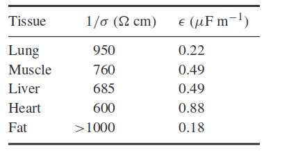
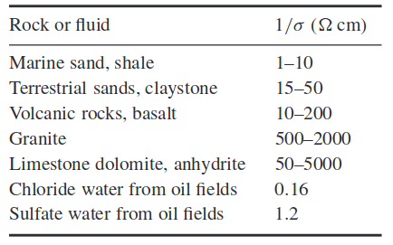
_Impedance of different materials and tissues at 10 kHz [2]_

#### Geometry

The geometry of EIT is very different from X-ray CT. In CT, almost all X-ray
photons travel to the detector along straight lines, which makes the forward
model simple. In EIT, the current does not flow in straight lines. It spreads
through the whole volume along curved paths, as in the figure below. Notice that
the current lines become sparser toward the center of the object. This is why
the spatial resolution of EIT drops in the middle of the imaged region.

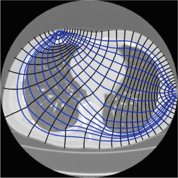
_Geometry of impedance measurements [3]_

#### Measurement Strategies

Which electrodes inject current and which ones measure voltage is a design
choice. Changing this pattern trades off spatial resolution and SNR in
different parts of the image, so different body regions call for different
strategies.

**Neighboring method.** Current is injected through a pair of adjacent
electrodes and the voltage is measured across all the other adjacent pairs.
Then the current source moves to the next pair, and the process repeats until
it has gone around the whole circle. This method gives better resolution near
the boundary.

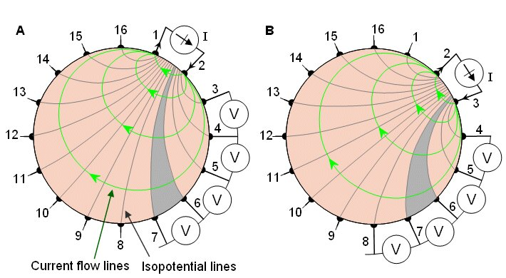
_The neighboring method [3]_

**Cross method.** Current is injected between electrodes on crossing sides and
the voltages are again read from the remaining electrode combinations. The
injection pair is then rotated around the circle.

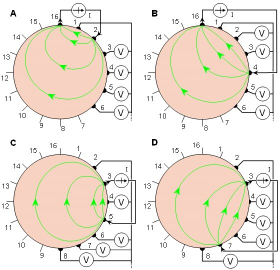
_The cross method [3]_

**Opposite method.** Current is injected through diametrically opposite
electrodes, the voltages are measured, and the injection pair is rotated around
the circle. Because the current passes straight through the body, this method
gives better resolution in the center.

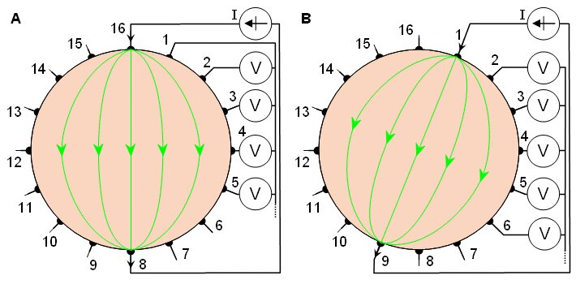
_The opposite method [3]_

#### Image Reconstruction

Reconstruction in EIT is much harder than in CT, because the inverse problem is
nonlinear and ill posed: very different conductivity distributions can produce
almost the same boundary voltages. A classic and fast approach is the
Barber-Brown back projection, which is conceptually similar to filtered back
projection in CT, except that the measurements are projected back along
equipotential lines instead of straight lines. More modern systems use
regularized, linearized solvers built on a finite element model of the body. As
an example, the figure below shows how lung imaging for volume measurement can
be modelled.

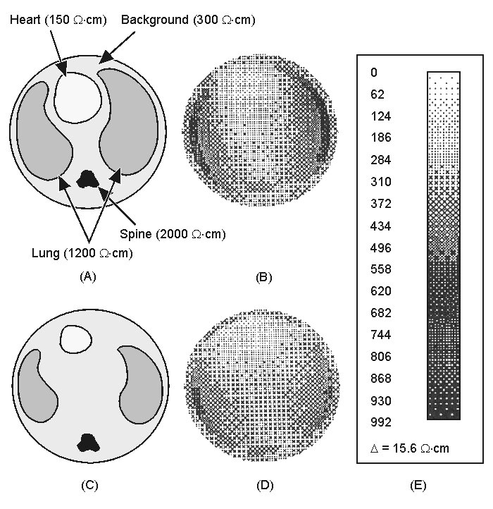
_Example reconstruction [1]_

#### Spatial Resolution

Spatial resolution is one of the most critical limitations of EIT, because it is
bounded by how many electrodes you can place over the region of interest.
Commercial systems typically use 16 electrodes, and some research systems use
32. Still, a few studies have pushed resolution much further.

One impressive example images evoked neural activity in the brain of a rat
using a planar electrode array placed directly on the cortex. The array packs
many electrodes into an area of about 6 mm x 5 mm and reaches a spatial
resolution of around 200 µm [4].

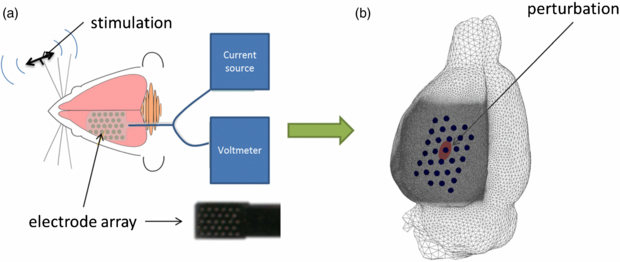
_Electrical impedance tomography using intracranial planar arrays [4]_

Since the electrodes lie on a plane, resolution depends on depth: the deeper you
go into the brain, the coarser the reconstruction becomes. The mesh used in the
study reflects this. The finest elements are kept directly under the array down
to a certain depth, and then the element size grows linearly toward the
opposite side.

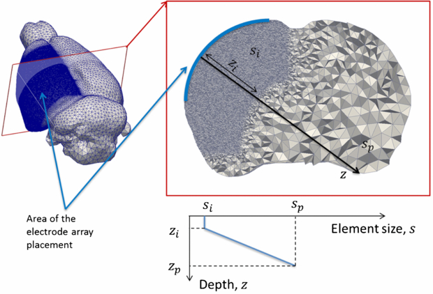
_Mesh element size grows with depth below the planar array [4]_

#### Advantages and Disadvantages

| Advantages            | Disadvantages                    |
| --------------------- | -------------------------------- |
| Non-invasive          | Rarely used and not well known   |
| Non-ionizing          | Electrode contact problems       |
| Compact and portable  | Low spatial resolution           |
| Inexpensive           |                                  |
| High time resolution  |                                  |

### Applications

#### Lung Monitoring

Lung monitoring was the first commercial clinical application of EIT, and it is
a natural fit. Patients in intensive care need continuous monitoring, and EIT
devices are small enough to stay at the bedside. The electrodes are attached
with a belt around the chest, and the lungs can be imaged for 24 hours at about
50 frames per second [5].

The first commercial product was the Dräger PulmoVista 500, which uses 16
electrodes. Early prototypes used separately attached electrodes, which were
later replaced by a single electrode belt.

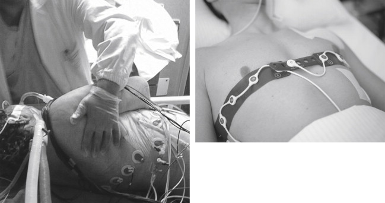
_Left: early setup with separate electrodes fixed to the patient. Right: the
individual electrodes are replaced by an electrode belt [6]_

Clinicians can follow the regional ventilation of the lungs directly from the
bedside screen, which also gives a good sense of the spatial resolution in
practice.

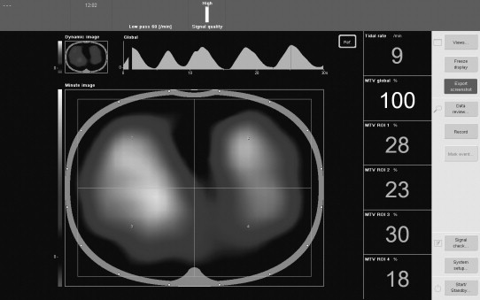
_Bedside screen where the patient's lung images can be followed continuously
[5]_

EIT is also used to monitor lung ventilation in newborns. Because it is
non-invasive and involves no ionizing radiation, it is particularly suitable for
fragile patients such as preterm infants.

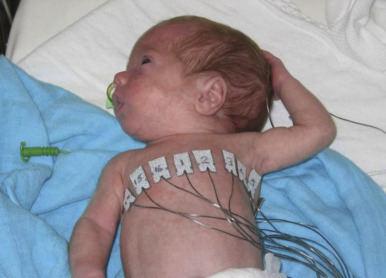
_Electrode placement for monitoring lung volume changes in a preterm infant [6]_

#### Breast Imaging

In 2014, a group in Malaysia evaluated an EIT based breast imaging device for
cancer screening on 150 women over 40 years old [7]. The device uses a 6 cm x 6
cm planar array with 256 electrodes and a 50 kHz excitation current.

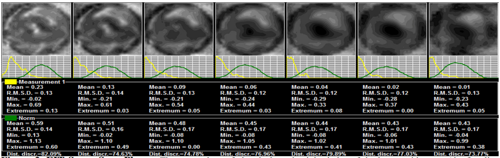
_Seven breast slices captured with the EIT device. The second row shows the
conductivity distribution of each slice [7]_

#### Tomo: Gesture Recognition with EIT

Tomo is a project from Carnegie Mellon University that uses EIT to recognize
hand gestures with a small wristband [8]. The band has 8 electrodes, runs at a
40 kHz excitation frequency, and is built from low cost parts. The
cross-sectional impedance images of the wrist are fed into a machine learning
classifier that predicts the current hand gesture.

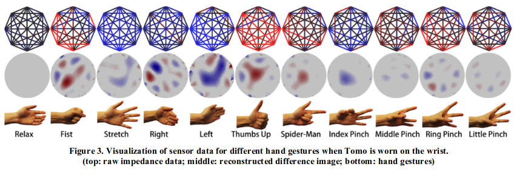
_Reconstructed cross sections of the wrist for different hand gestures [8]_

The confusion matrices below show the classification accuracy when the band is
worn on the wrist and on the arm. One of the key issues the authors mention is
electrode contact: the electrodes need to sit tightly on the skin, and a poor
contact quickly hurts classification accuracy.

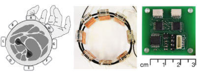
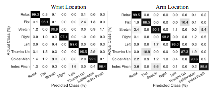
_Confusion matrices for the hand gesture set when Tomo is worn on the wrist
(top) and on the arm (bottom) [8]_

#### Spectra: Open Source Biomedical Imaging

Spectra, by Mindseye Biomedical, is an open source project that aims to make
biomedical imaging accessible to everyone [9]. Its EIT board is meant for both
hardware and algorithm research. It costs around 400 dollars, supports up to 32
electrodes, has an adjustable excitation frequency from 1 kHz to 160 kHz, and
comes with a web interface for testing reconstruction algorithms in real time.

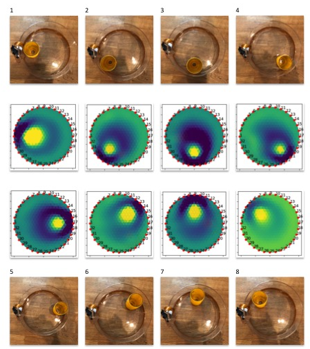
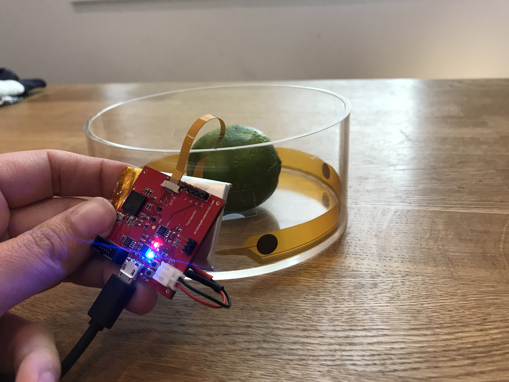
_Spectra development board while testing with an EIT phantom [9]_

The board has a small form factor and can be tested directly on a phantom
through a circular electrode array with a ready to use connector.

### Open Problems and Future Directions

EIT is already useful in practice, but there is still a lot of room for
improvement.

**Physical setup**

- Water bath based solutions
- Higher electrode counts
- The skin to electrode interface and its capacitance

**Spatial resolution**

- Better methods for the ill posed inverse problem
- Modelling 3D current paths instead of assuming 2D slices
- Multi-frequency impedance measurements
- Combining EIT with other imaging modalities

### Conclusion

EIT is a young imaging modality with a lot of potential. Its low cost and
portability set it apart from the other modalities, and it is especially
attractive when tissue needs to be imaged continuously for long periods. I
expect it to find many new applications in the coming years, and maybe one day
it will help make biomedical imaging accessible to people all around the world.

### References

1. J. L. Oschman, "Chapter 6: Electricity and Magnetism in Diagnosis and
   Therapeutics," in _Energy Medicine_, 2nd ed., Churchill Livingstone, 2016,
   pp. 75 to 99.
2. L. Borcea, "Electrical Impedance Tomography," _Inverse Problems_, 2002.
3. J. Malmivuo and R. Plonsey, _Bioelectromagnetism_, Chapter 26: Impedance
   Tomography, Oxford University Press, 1995.
4. K. Aristovich, G. Sato dos Santos, B. Packham, and D. Holder, "A method for
   reconstructing tomographic images of evoked neural activity with electrical
   impedance tomography using intracranial planar arrays," _Physiological
   Measurement_, vol. 35, p. 1095, 2014.
5. S. Grimnes and Ø. G. Martinsen, "Chapter 10: Selected Applications," in
   _Bioimpedance and Bioelectricity Basics_, 3rd ed., Academic Press, 2015.
6. J. Stocks and S. Lum, "Pulmonary Function Tests in Infants and Preschool
   Children," in _Kendig and Chernick's Disorders of the Respiratory Tract in
   Children_, 8th ed., W.B. Saunders, 2012.
7. N. Mohd Zain and K. Chelliah, "Breast Imaging Using Electrical Impedance
   Tomography: Correlation of Quantitative Assessment with Visual
   Interpretation," _Asian Pacific Journal of Cancer Prevention_, vol. 15, pp.
   1327 to 1331, 2014.
8. Y. Zhang and C. Harrison, "Tomo: Wearable, Low-Cost Electrical Impedance
   Tomography for Hand Gesture Recognition," in _Proceedings of UIST_, 2015.
9. J. Rintoul, "Mindseye Biomedical Spectra: Open Source Biomedical Imaging,"
   Crowd Supply, 2019.
   https://www.crowdsupply.com/mindseye-biomedical/spectra
