Hello everyone! In this post, I will recognize what a person is doing, such as
walking, sitting, or climbing stairs, from the accelerometer and gyroscope of a
smartphone. I will compare four models: a classic neural network on hand
crafted features, a plain LSTM, a CNN LSTM, and a Convolutional LSTM, trained
on the UCI Smartphone dataset and on a small dataset I recorded myself.

**Results in short:** the plain LSTM reached 90.6% validation accuracy, the CNN
LSTM 91.8%, and the Convolutional LSTM 89.1%, while the feature based baseline
stayed around 78%. The CNN LSTM was both the most accurate and much faster to
train than the plain LSTM.

### Human Activity Recognition

Human activity recognition (HAR) is a popular machine learning problem, and
recent work shows that deep networks, especially LSTMs, do very well on it [1].
Almost every phone and smartwatch carries the two sensors that matter most:

- **Accelerometer:** measures linear acceleration along three axes, typically
  within a range of a few g.
- **Gyroscope:** measures angular velocity around three axes.

The two complement each other. The accelerometer is noisy while the device is
moving, and the gyroscope drifts over time, so their readings are usually
combined with sensor fusion to get a reliable estimate of the device's motion
and orientation.

A typical HAR pipeline looks like the figure below. Sensor data is collected,
often sent to the cloud, cleaned and filtered, and then passed to a deep
learning model that extracts features and classifies the activity. Deep
learning makes it possible to recognize more complex activities, and the more
complex the activities we can recognize, the more useful HAR becomes. As the
number of wearables grows, so does the amount of data and the compute needed to
process it, which is why accurate and cost effective models matter.

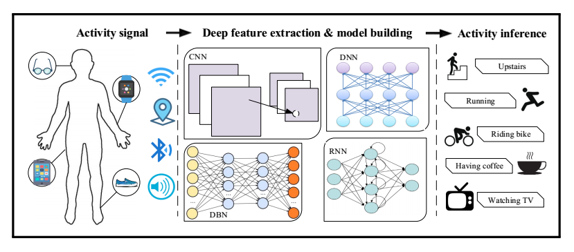
_Human activity recognition pipeline_

### Datasets

#### UCI Smartphone Dataset

The UCI HAR dataset [2] was recorded from 30 volunteers aged 19 to 48, each
wearing a smartphone on the waist while performing six activities: walking,
walking upstairs, walking downstairs, sitting, standing, and lying down. Each
session was video recorded and labelled by hand. Sensors were sampled at 50 Hz
and the signals are split into windows of 128 samples (2.56 seconds).

After preprocessing, the training set has 7352 windows and the validation set
has 2947. Each window is 128 time steps long with 9 channels (body and total
acceleration plus angular velocity, each on three axes), and each label is a
one hot vector over the 6 classes.

#### My Own Dataset

I also collected a small dataset with a phone app I wrote in DroidScript. It has
80 recordings from 4 people sampled at 20 Hz, with labels that describe the
context as well as the movement: sitting in a car, at home, on a bus, at a
computer, or on the metro, standing on a bus or on the metro, standing while
waiting, walking outside, and running. After splitting into windows of 100
samples (5 seconds), there are 708 training and 178 validation windows, each
with 7 channels.

The label distributions are shown below. The UCI dataset is well balanced,
while mine is not, since some activities were simply much easier to record for
longer.

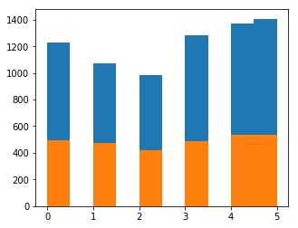
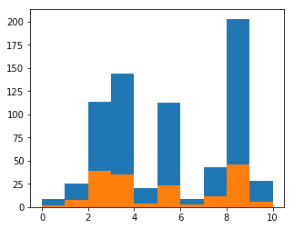
_Label distribution of the UCI dataset (top) and my own dataset (bottom)_

### Preprocessing

For the deep models, I did not compute any hand crafted features and fed the
raw signals directly. The data was normalized per person, so that differences
between how individuals move or carry their phone matter less, then split into
windows and shuffled. The network never sees which person a window came from.

### Models

#### Baseline: Hand Crafted Features and a Dense Network

As a baseline, each window is summarized with a set of classic features per
axis: the maximum, the standard deviation, the skewness, and frequency domain
values. This turns every window into a 396 dimensional feature vector, which is
classified by a small fully connected network.

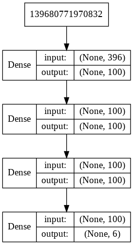
_Layers of the feature based baseline network_

#### LSTM

Recurrent neural networks (RNNs) give a network memory by feeding the output
of a step back into the next step. You can picture them as the same cell
unrolled over the sequence.

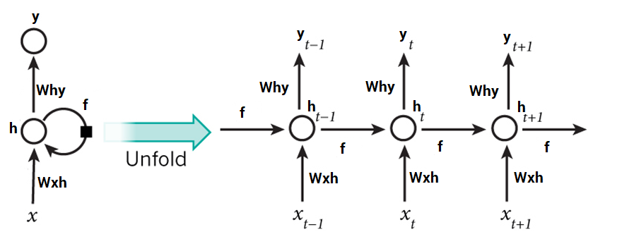
_An RNN unrolled over time [3]_

Plain RNNs struggle with long sequences, which is known as the problem of
long-term dependencies. The hidden state passes through a nonlinearity at every
step, and the gradients that flow back through all these steps tend to vanish
or explode. In practice, information from early in the sequence gets lost.

The LSTM solves this with a second path through the cell, the _cell state_,
often called the conveyor belt. It is the top line in the figure below, and it
is only touched by an elementwise multiplication (the forget gate) and an
addition (the input gate). With no squashing nonlinearity on this path,
information and gradients can survive across many more time steps [3].

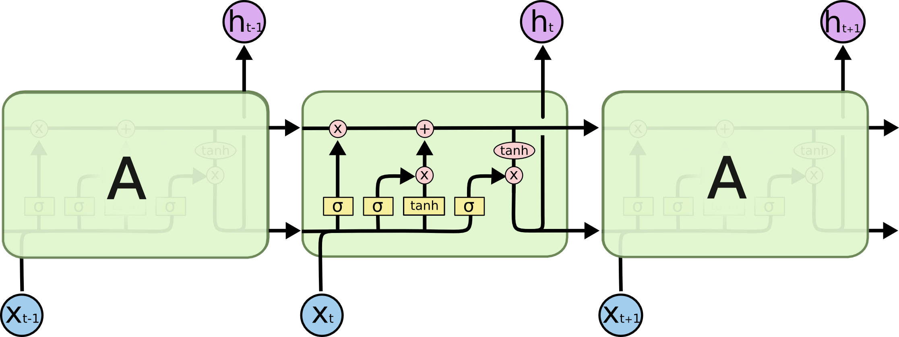
_Structure of an LSTM cell [3]_

The LSTM model I used has four layers. It takes a 128 x 9 window and outputs a
probability for each of the 6 classes.

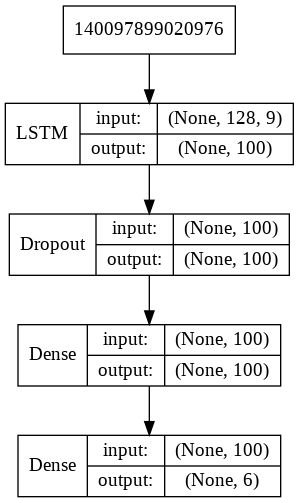
_Layers of the LSTM model_

#### CNN LSTM

The CNN LSTM works in two stages [4]. First, 1D convolutions extract local
features from short chunks of the window. These features are flattened and
passed as a much shorter sequence to the LSTM layers, which model how they
change over time and make the final prediction.

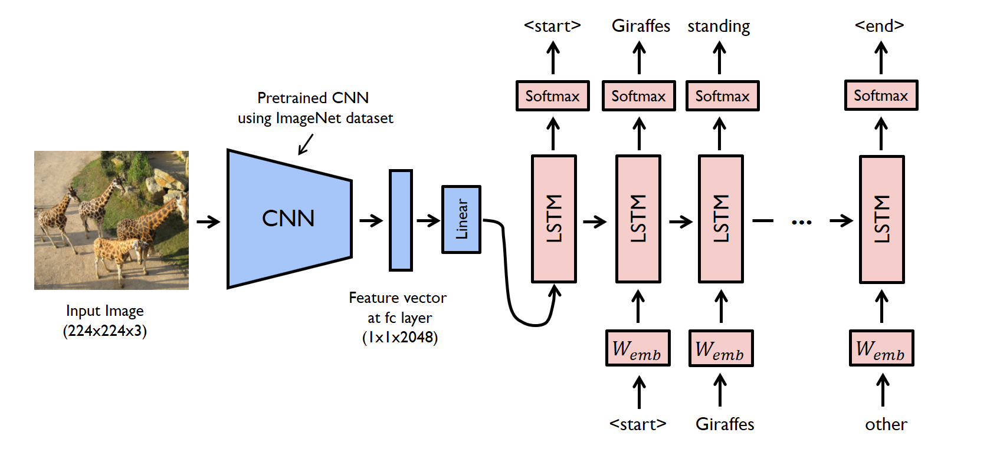
_Structure of a CNN LSTM network_

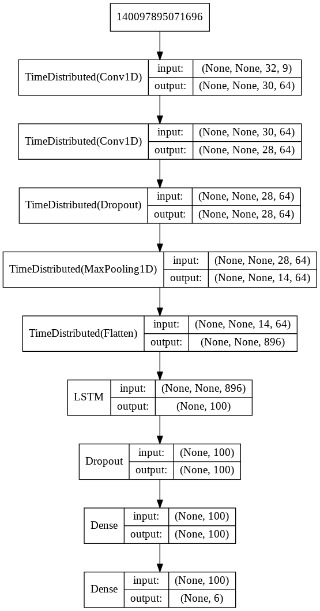
_Layers of the CNN LSTM model_

#### Convolutional LSTM

The Convolutional LSTM (ConvLSTM) [5] goes one step further and puts the
convolution inside the LSTM cell itself: the input to state and state to state
transitions are convolutions instead of matrix multiplications. The signal is
treated as a 2D array, like an image, and unlike the CNN LSTM the outputs are
not flattened before the recurrent part.

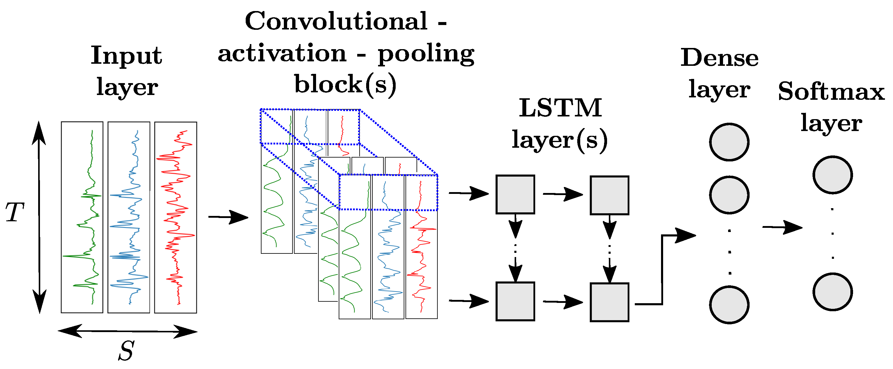
_Structure of a Convolutional LSTM network_

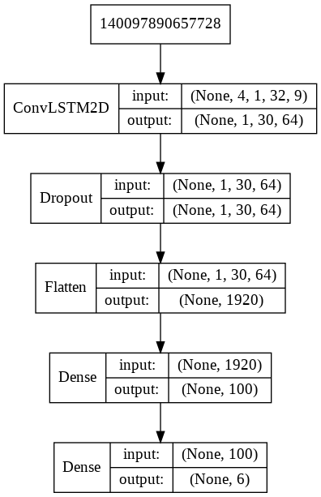
_Layers of the Convolutional LSTM model_

#### Loss Function and Training

All four models end with a fully connected softmax layer that outputs class
probabilities. They are trained with the categorical cross entropy loss:

$$CE = -\sum_{i=1}^{C} t_i \log(s_i)$$

where $C$ is the number of classes, $t_i$ is 1 for the correct class and 0
otherwise, and $s_i$ is the predicted probability of class $i$. The loss is
small when the model puts a high probability on the correct class.

Training minimizes this loss with the Adam optimizer, a variant of gradient
descent. Each step runs a forward pass to compute the loss, uses
backpropagation to compute the gradient of the loss with respect to every
weight, and moves the weights a small step against the gradient. This repeats
for every batch, over many epochs.

### Results

All models were trained on an NVIDIA K80 GPU in Google Colab. For each model,
the first pair of plots shows accuracy and loss on the training and validation
sets per epoch, and the second pair shows confusion matrices for the training
and validation sets.

#### Baseline

The feature based network trains in about a second per epoch, but it overfits
heavily: training accuracy goes up to 99% while validation accuracy stays
around 78%.

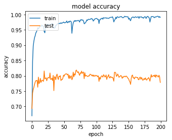
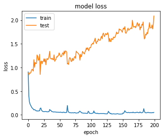
_Final epoch: loss 0.052, accuracy 99.1%, validation loss 2.087, validation
accuracy 77.8%_

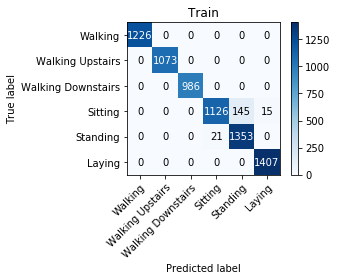
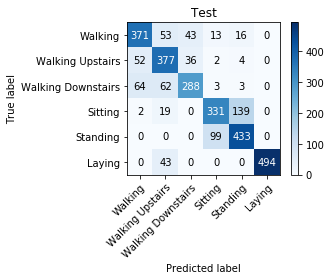
_Confusion matrices for the baseline network_

#### LSTM

The LSTM ran for 60 epochs at about 42 seconds each. The loss went down for
almost the whole run, apart from a sudden spike around epochs 13 to 16. It
ended at 90.6% validation accuracy.

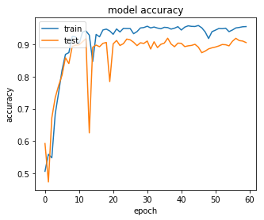
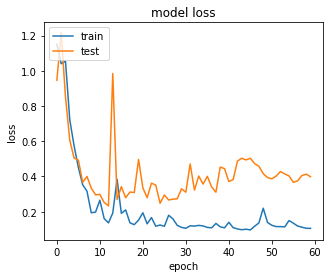
_Final epoch: loss 0.105, accuracy 95.6%, validation loss 0.398, validation
accuracy 90.6%_

The confusion matrices show where the errors come from: sitting and standing.
Both are static postures, and with a phone on the waist they produce very
similar signals, so the LSTM cannot reliably tell them apart. On the validation
set, about 200 sitting and standing windows are swapped. The walking classes
have a few mix ups, and lying down is classified perfectly.

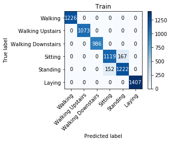
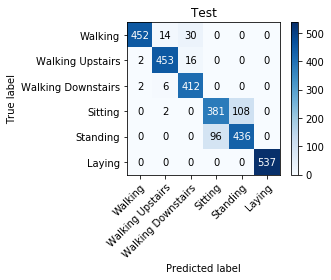
_Confusion matrices for the LSTM_

#### CNN LSTM

The CNN LSTM is the most complex architecture here, yet it trains much faster:
about 17 seconds per epoch, and 25 epochs were enough. The convolutions shrink
the 128 step window into a much shorter sequence of features, so the LSTM has
far fewer sequential steps to process, and convolutions themselves parallelize
well on a GPU. It reached the best validation accuracy, 91.8%.

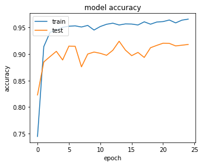
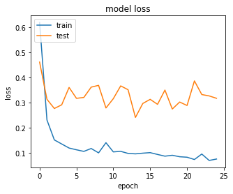
_Final epoch: loss 0.076, accuracy 96.6%, validation loss 0.318, validation
accuracy 91.8%_

Sitting and standing remain the main source of confusion. The gain over the
plain LSTM is mostly in training time rather than accuracy.

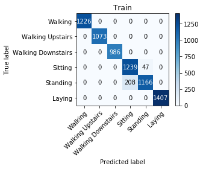
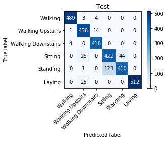
_Confusion matrices for the CNN LSTM_

#### Convolutional LSTM

The Convolutional LSTM learns fastest: it passes 90% validation accuracy after
only 5 epochs, at about 29 seconds each, which makes it attractive for larger
datasets. However, its validation loss is noticeably higher, and it finished at
89.1% validation accuracy.

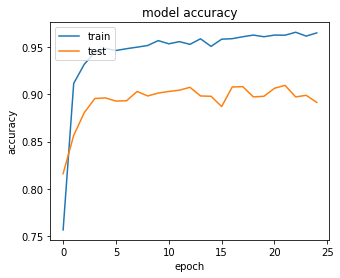
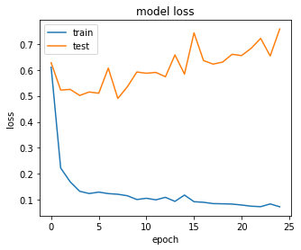
_Final epoch: loss 0.074, accuracy 96.5%, validation loss 0.757, validation
accuracy 89.1%_

It separates sitting and standing slightly better than the plain LSTM, but in
exchange it confuses the walking classes more, often predicting walking
downstairs for walking or walking upstairs. It also labels some sitting and
lying down windows as walking upstairs, which the other models never do.

_Confusion matrices for the Convolutional LSTM_

#### LSTM on My Own Dataset

Finally, I trained the LSTM on my own dataset. With far less data, an epoch
took only 2 seconds, and after 60 epochs the validation accuracy was 90.4%.

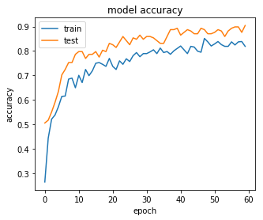
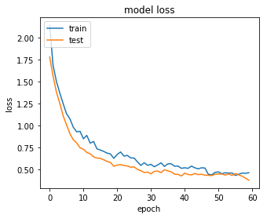
_Final epoch: loss 0.461, accuracy 81.9%, validation loss 0.375, validation
accuracy 90.4%_

The biggest confusion is between standing on a bus and standing while waiting.
Both are mostly standing still with small movements, so this is not
surprising.

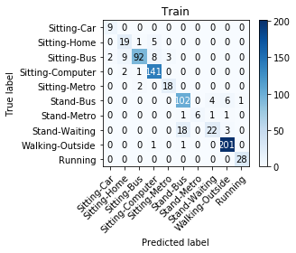
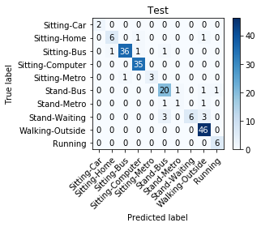
_Confusion matrices for the LSTM on my own dataset_

### Summary

| Model                    | Validation accuracy | Time per epoch | Epochs         |
| ------------------------ | ------------------- | -------------- | -------------- |
| Features + dense network | 77.8%               | about 1 s      |                |
| LSTM                     | 90.6%               | 42 s           | 60             |
| CNN LSTM                 | 91.8%               | 17 s           | 25             |
| Convolutional LSTM       | 89.1%               | 29 s           | 5 to reach 90% |
| LSTM, own dataset        | 90.4%               | 2 s            | 60             |

### Conclusion

LSTMs work very well on long sensor time series and give solid results without
much compute or any hand crafted features. Putting convolutional feature
extractors in front of the LSTM, as in the CNN LSTM, gave the best accuracy
and cut training time by more than half, since the LSTM only has to process a
compact sequence of features. The remaining errors come mostly from activities
that look the same to a waist mounted sensor, such as sitting and standing.

### Future Work

- Test the models on the UCSD ExtraSensory dataset, which captures behavioral
  context in the wild from phones and smartwatches [6].
- Try feature extraction, signal filtering, other normalization schemes, and
  data augmentation on that dataset to improve accuracy.
- Apply the same models to accelerometer based gesture recognition, for example
  the SmartWatch Gestures dataset [7].

### References

1. T. Zebin, N. Peek, A. Casson, and M. Sperrin, "Human activity recognition
   from inertial sensor time-series using batch normalized deep LSTM recurrent
   networks," in _Proc. IEEE EMBC_, 2018.
2. D. Anguita, A. Ghio, L. Oneto, X. Parra, and J. L. Reyes-Ortiz, "Human
   Activity Recognition on Smartphones Using a Multiclass Hardware-Friendly
   Support Vector Machine," in _Ambient Assisted Living and Home Care_,
   Springer, 2012.
3. C. Olah, "Understanding LSTM Networks," 2015.
   https://colah.github.io/posts/2015-08-Understanding-LSTMs/
4. T. N. Sainath, O. Vinyals, A. Senior, and H. Sak, "Convolutional, Long
   Short-Term Memory, fully connected Deep Neural Networks," in _Proc. IEEE
   ICASSP_, 2015.
5. X. Shi, Z. Chen, H. Wang, D.-Y. Yeung, W.-K. Wong, and W.-C. Woo,
   "Convolutional LSTM Network: A Machine Learning Approach for Precipitation
   Nowcasting," arXiv:1506.04214, 2015.
6. Y. Vaizman, K. Ellis, and G. Lanckriet, "Recognizing Detailed Human Context
   in the Wild from Smartphones and Smartwatches," _IEEE Pervasive Computing_,
   vol. 16, no. 4, 2017.
7. L. Porzi, S. Messelodi, C. Modena, and E. Ricci, "A smart watch-based gesture
   recognition system for assisting people with visual impairments," 2013.
